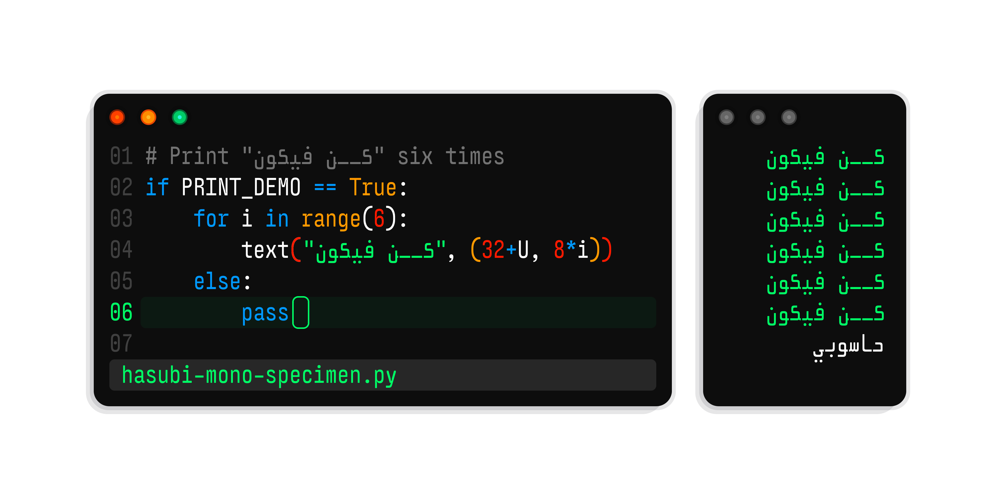
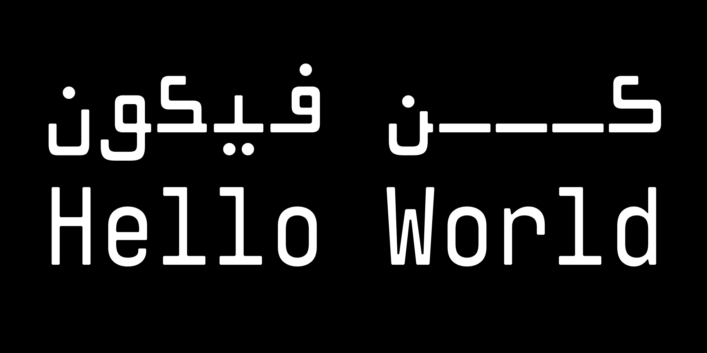
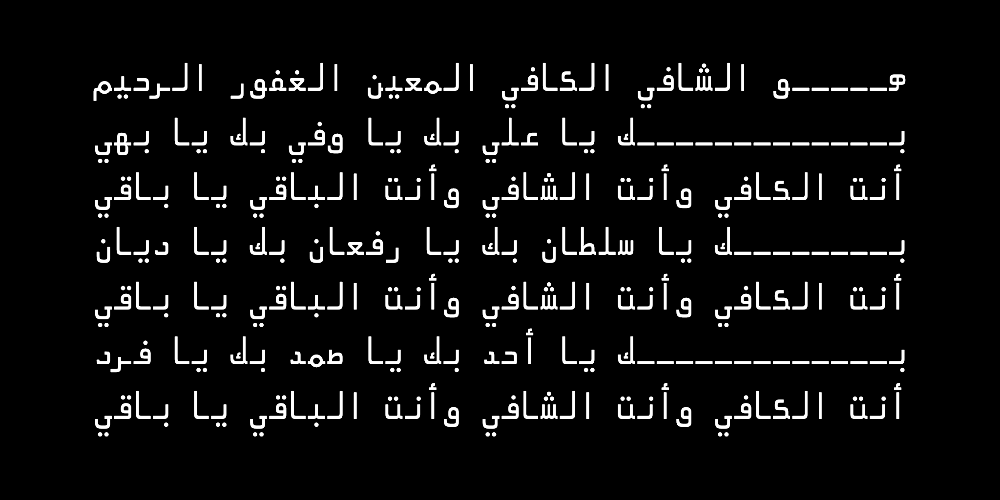
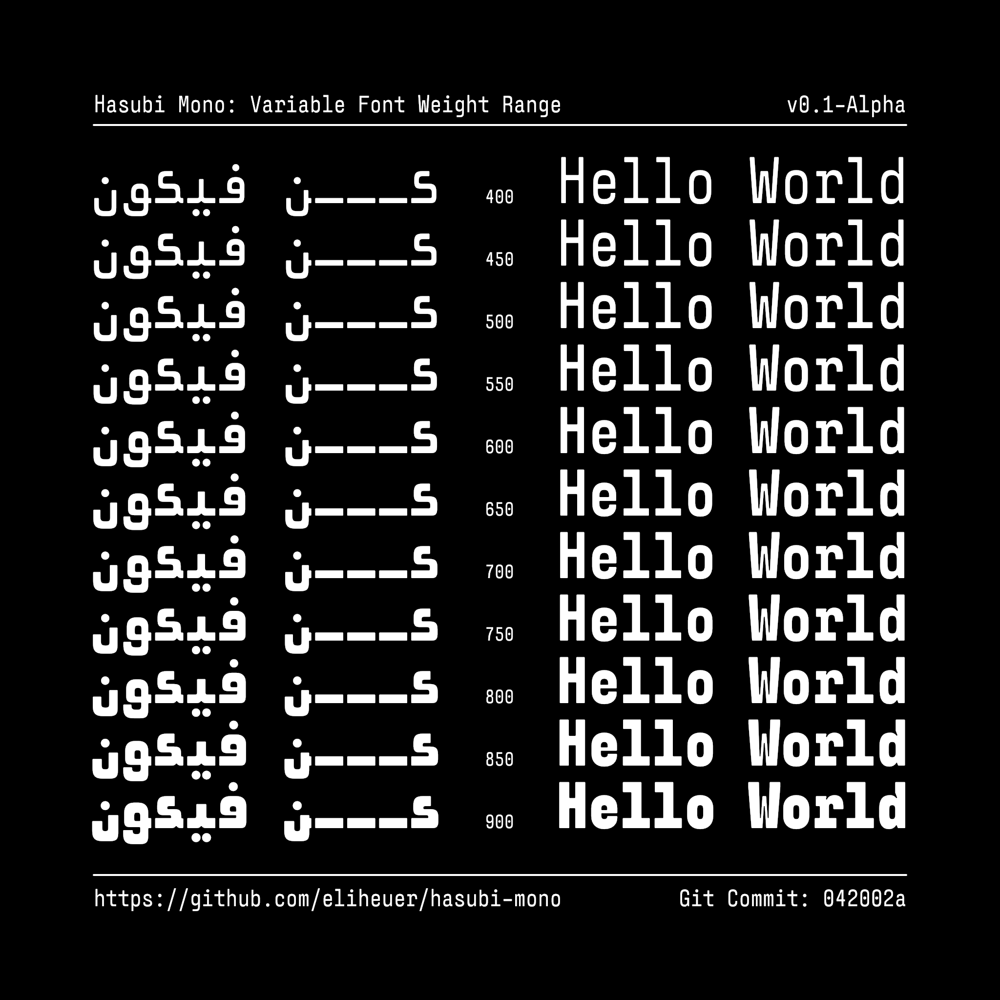
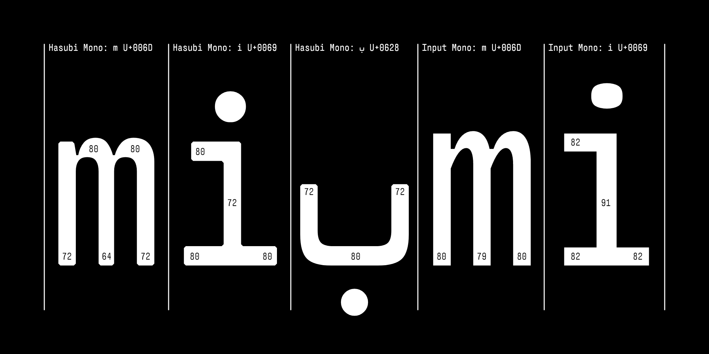
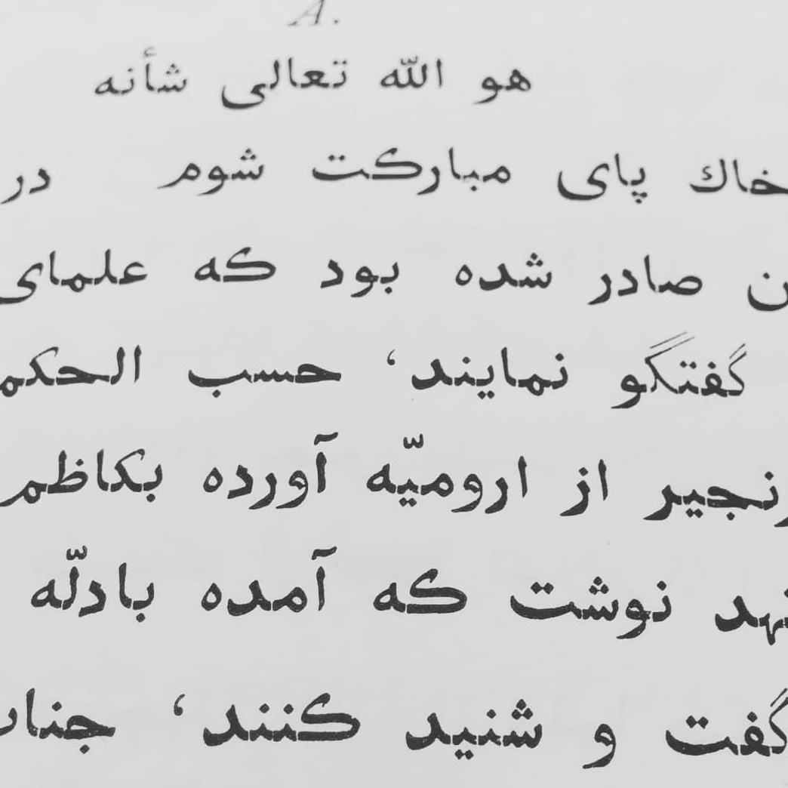

# Hasubi Mono (حاسوبي مونو)

Hasubi Mono (حاسوبي مونو) is a condensed horizontal-contrast monospace designed by Eli Heuer for editing Arabic and Persian text and code in terminals. Hasubi is a transliteration of حاسوبي, “my computer.”

**In development.** The current weight axis runs from Regular to Black (400–900). Latin and Arabic drawings are in progress. Hebrew is planned for the first release. The current sources contain placeholders for its 27 letters.

[Print proof](https://eliheuer.github.io/hasubi-mono/proof.pdf) · [Google Fonts preparation](documentation/google-fonts.md)

# Design Notes
Hasubi Mono has a few unique features that need some explanation, such as horizontal contrast and the GAPS axis.

## Horizontal Contrast
Hasubi mono was designed specifically for people who work with Arabic and Hebrew in text editors and terminals. Because the whole typeface shares a horizontal-contrast based drawing style that originates from the Arabic, the font is extremly condensed allowing a terminal user to make better use of screen space, or a designer to fit more text into a small space. See the below image comparing Hasubi Mono with Input Mono Compressed as an example. Note that Input Mono Compressed is one of the narrowest monospace fonts avaiable today, so the fact that Hasubi Mono is slightly more narrow while also including the Arabic alphabet should be somewhat impressive once the design problems around fonts like this are fully understood.

## Gaps Axis
The Arabic glyphs have gaps. A proposed GAPS axis would interpolate between open and closed gaps. This style is inspired by the look of Arabic printing in older books printed with metal type. Specifically the book [Materials for the Study of the Bábí Religion](https://archive.org/details/materialsforstud0000brow) published in 1918 by Cambridge University Press, which the designer of this typeface read while learning Arabic and noticed that the gaps were helpful for a beginner Arabic reader. See a photo example below:

# Building

Run `make setup`, `make build`, `make test` and `make proof`. The editable sources are the top-level Hasubi designspace and its Regular and Black UFOs. Build details and publishing instructions are in the [build guide](documentation/build.md).

[Current print proof](https://eliheuer.github.io/hasubi-mono/proof.pdf) · [Historical DrawBot print specimen](documentation/drawbot/hasubi-mono-print-proof.pdf)

# License

This Font Software is licensed under the SIL Open Font License, Version 1.1.
This license is available with a FAQ at
https://scripts.sil.org/OFL

# Repository Layout

The [Font.Garden workflow](AGENTS.md) covers agent assignments and review. [Hasubi’s design rules](CONTEXT.md) describe the construction and the source colors.

# Changelog

**10 Jan 2023. Version 0.001**
- Added new images to the main README
- Almost done with Arabic drawings

**01 May 2022. Version 0.001**
- Set up a basic variable font with weight range 400-900
- Added new DrawBot images

